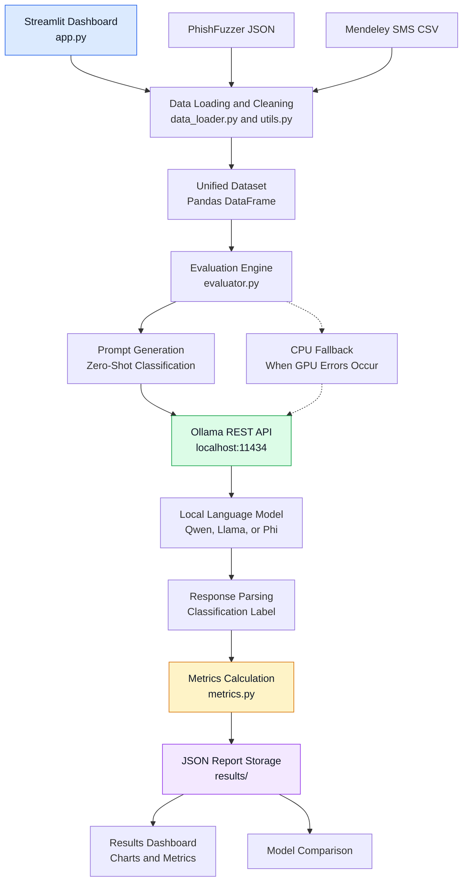
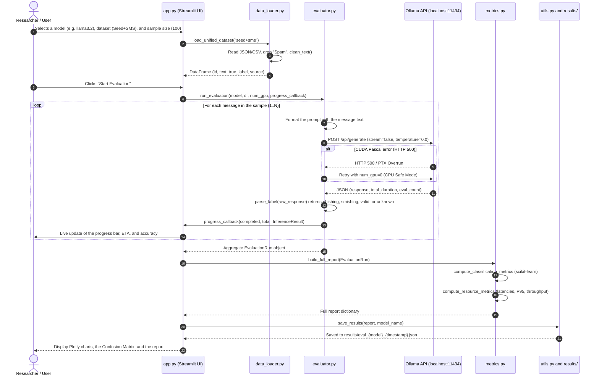
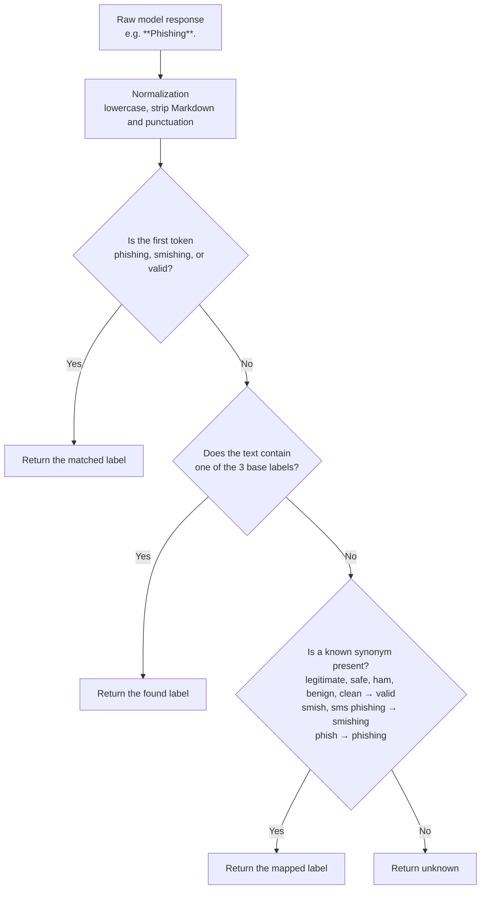

# MarkerPhish — Technical Documentation and System Architecture

> **Engineering Thesis Documentation**  
> *A platform for evaluating the effectiveness of language models in phishing and smishing detection while optimizing resource usage.*

---

## Table of Contents
1. [Introduction and Platform Goals](#1-introduction-and-platform-goals)
2. [Global System Architecture](#2-global-system-architecture)
3. [Data Flow Diagram](#3-data-flow-diagram)
4. [Detailed Description of Modules and Files](#4-detailed-description-of-modules-and-files)
   - [4.1 config.py — Global Configuration and Constants](#41-configpy--global-configuration-and-constants)
   - [4.2 data_loader.py — Data Preparation Pipeline](#42-data_loaderpy--data-preparation-pipeline)
   - [4.3 evaluator.py — Inference Engine and Ollama Communication](#43-evaluatorpy--inference-engine-and-ollama-communication)
   - [4.4 metrics.py — Analytics and Quality Metrics Module](#44-metricspy--analytics-and-quality-metrics-module)
   - [4.5 utils.py — Helper Utilities and Data Persistence](#45-utilspy--helper-utilities-and-data-persistence)
   - [4.6 app.py — Interactive Streamlit Dashboard](#46-apppy--interactive-streamlit-dashboard)
   - [4.7 run.bat and the .venv](#47-runbat-and-the-venv)
5. [Prompt Engineering](#5-prompt-engineering)
6. [Response Parsing Strategy (NLP Extraction)](#6-response-parsing-strategy-nlp-extraction)
7. [Hardware Optimization and GPU Error Handling (Pascal Fallback)](#7-hardware-optimization-and-gpu-error-handling-pascal-fallback)
8. [JSON Output File Structure](#8-json-output-file-structure)
9. [Performance and Quality Metrics](#9-performance-and-quality-metrics)

---

## 1. Introduction and Platform Goals

**MarkerPhish** is a modular experimental research platform written in Python and designed for automated, repeatable testing of local large language models (LLMs) for the detection of social engineering attacks:
- **Phishing (Email):** Email messages designed to steal identities, login credentials, or money.
- **Smishing (SMS):** Deceptive or malicious SMS text messages.
- **Valid (Legitimate / Ham):** Legitimate and safe messages.

A key feature of the project is the simultaneous analysis of **classification effectiveness** (accuracy, precision, recall, per-class and macro F1) and **computational cost** (inference time, P95 latency, messages per minute, and model size in memory).

---

## 2. Global System Architecture

The system consists of five main layers: the user interface, data processing, model evaluation, local LLM execution, and results analysis. These components work together to evaluate phishing and smishing detection performance.



### Architecture Overview

- **Presentation:** Streamlit provides experiment configuration, progress monitoring, and result visualization.
- **Data Processing:** JSON and CSV datasets are cleaned, filtered, and combined into a unified DataFrame.
- **Evaluation:** The evaluation engine prepares prompts, sends requests to Ollama, and parses model responses.
- **Local Inference:** Ollama runs the selected language model locally. CPU fallback can be used when GPU errors occur.
- **Analytics and Storage:** Classification and resource metrics are calculated and saved as JSON reports for visualization and model comparison.

---

## 3. Data Flow Diagram

The following sequence diagram illustrates the full path of a single record and the complete evaluation cycle:



---

## 4. Detailed Description of Modules and Files

### 4.1 [config.py](config.py) — Global Configuration and Constants
This file is the central repository for parameters, paths, and rules.

* **Path resolution:**
  - `PROJECT_ROOT`: Automatically locates the project root directory (`os.path.dirname(os.path.abspath(__file__))`). Ensures runtime independence and avoids hard-coded paths.
  - `DATA_DIR`: Path to the `Data/` directory.
  - `RESULTS_DIR`: Path to the `results/` directory.
  - Dataset paths: `PHISHFUZZER_SEED`, `PHISHFUZZER_REPHRASED`, `SMISHING_CSV`.
* **Label mapping and filtering:**
  - `PHISHFUZZER_LABEL_MAP`: Maps `Phishing` -> `phishing`, `Valid` -> `valid`. The `Spam` label is intentionally skipped (discarded).
  - `SMISHING_LABEL_MAP`: Maps `smishing` -> `smishing`, `ham` -> `valid`. The `spam` label is intentionally discarded.
  - `VALID_LABELS`: Set of allowed target classes: `{"phishing", "smishing", "valid"}`.
* **Ollama API parameters:**
  - `OLLAMA_BASE_URL`: Default: `http://localhost:11434`.
  - `OLLAMA_GENERATE_ENDPOINT`, `OLLAMA_TAGS_ENDPOINT`, `OLLAMA_SHOW_ENDPOINT`.
  - `DEFAULT_NUM_GPU`: Defaults to `0` (CPU fallback for stability on Pascal-architecture GPUs).
  - `OLLAMA_TEMPERATURE = 0.0`: Deterministic generation (reproducibility), eliminating randomness in scientific evaluation.
  - `OLLAMA_TOP_P = 1.0`, `OLLAMA_NUM_CTX = 2048`, `OLLAMA_NUM_PREDICT = 25`.
* **Prompt template (`CLASSIFICATION_PROMPT`):**
  A strict system prompt that assigns the model the role of a cybersecurity expert and requires it to return exactly one of the three labels, with no additional text.

---

### 4.2 [data_loader.py](data_loader.py) — Data Preparation Pipeline
Responsible for loading and cleaning data, discarding commercial spam, and unifying the input data format.

#### Key Functions:
1. `_load_phishfuzzer_json(path, source_tag)`:
   - Opens a JSON file from the PhishFuzzer corpus.
   - Reads the `Type` field. If the type is `Spam`, the record is immediately discarded.
   - Combines the `Subject` and `Body` fields into a single logical unit (`Subject: {subject}\n\n{body}`).
   - Cleans the text using `clean_text()`. Empty messages are skipped.
2. `load_phishfuzzer_seed()`:
   - Loads the base dataset (3,300 raw records -> approx. 2,226 records after discarding spam).
3. `load_phishfuzzer_rephrased()`:
   - Loads the synthetically rephrased variant (19,800 raw records -> approx. 13,356 after filtering).
4. `load_smishing_csv()`:
   - Loads the Mendeley SMS dataset (`Dataset_10191.csv`).
   - Maps `smishing` -> `smishing` and `ham` -> `valid`, and discards `spam` (approx. 6,794 records retained).
5. `load_unified_dataset(choice)`:
   - Accepts one of the following options: `"seed+sms"`, `"seed"`, `"rephrased"`, `"sms"`, `"rephrased+sms"`, `"all"`.
   - Merges the selected collections into a single `pandas.DataFrame` object.
   - Assigns unified `id` indices (from 1 to N).
   - Produces the data schema:
     `[id: int, text: str, true_label: str, source: str]`.

---

### 4.3 [evaluator.py](evaluator.py) — Inference Engine and Ollama Communication
The execution core of the platform, responsible for network communication, sending prompts, measuring time, and process stability.

#### Data Structures (`dataclass`):
* `InferenceResult`: The result of a single request:
  - `record_id`, `true_label`, `predicted_label`, `raw_response`, `latency_seconds`, `prompt_eval_count`, `eval_count`.
* `EvaluationRun`: Aggregate report of an entire evaluation session:
  - `model_name`, `model_size_bytes`, `total_records`, `completed`, `failed`, `results: list[InferenceResult]`, `start_time`, `end_time`.
  - Properties: `avg_latency`, `total_latency`, `elapsed_time`, and the `to_dataframe()` method.

#### Key Functions:
1. `check_ollama_connection() -> bool`:
   - Checks Ollama server availability via `GET /api/tags` with a 5-second timeout.
2. `list_available_models() -> list[dict]`:
   - Retrieves the list of locally installed models, their size on disk (in bytes), and their checksums (digest).
3. `classify_message(model_name, message_text, num_gpu) -> tuple`:
   - Fills the prompt template with the message.
   - Measures precise execution time using `time.perf_counter()`.
   - Sends an HTTP `POST /api/generate` request with `stream=False`.
   - **GPU Fallback:** On an error code (e.g. 500), retries the request on the CPU (`num_gpu=0`).
   - Calls `parse_label()` on the response text.
   - Returns `(predicted_label, raw_response, latency, metadata)`.
4. `run_evaluation(model_name, df, num_gpu, progress_callback) -> EvaluationRun`:
   - The main evaluation loop. Iterates over consecutive DataFrame rows.
   - Notifies the graphical interface of progress via `progress_callback` after each message.
   - Calls `gc.collect()` every 25 messages, preventing RAM leaks during long runs.

---

### 4.4 [metrics.py](metrics.py) — Analytics and Quality Metrics Module
Implements statistical calculations based on inference results using the `scikit-learn` and `numpy` libraries.

#### Key Functions:
1. `compute_classification_metrics(y_true, y_pred, labels)`:
   - Isolates unrecognized predictions (`unknown`).
   - Calculates:
     - `accuracy`: Overall model accuracy.
     - `precision_macro`, `recall_macro`, `f1_macro`: Unweighted arithmetic means of the metrics across all classes (crucial for imbalanced datasets).
     - `precision_weighted`, `recall_weighted`, `f1_weighted`: Means weighted by class frequency (*support*).
     - `per_class`: Dictionary of precision, recall, and F1 metrics separately for `phishing`, `smishing`, and `valid`.
     - `confusion_matrix`: A 3x3 confusion matrix in the form of a nested list:
       ```
       [ [TP_phish,      FN_as_smish, FN_as_valid],
         [FN_as_phish,   TP_smish,    FN_as_valid],
         [FP_phish,      FP_smish,    TN_valid] ]
       ```
     - `classification_report_text`: The raw, formatted text report from `sklearn.metrics.classification_report`.
2. `compute_resource_metrics(run: EvaluationRun)`:
   - Calculates performance parameters:
     - `avg_latency_s`, `median_latency_s`, `min_latency_s`, `max_latency_s`.
     - `p95_latency_s`: The 95th percentile of response time (eliminates the influence of individual anomalies/slowdowns).
     - `throughput_msgs_per_min`: Throughput calculated as $(N / T_{total}) \times 60$.
     - `model_size_mb`: Model weight size in megabytes.
3. `build_full_report(run: EvaluationRun)`:
   - Integrates quality metrics, resource metrics, class distributions, and the full history of raw predictions (`raw_predictions`) into a single dictionary ready for JSON serialization.

---

### 4.5 [utils.py](utils.py) — Helper Utilities and Data Persistence
Responsible for text sanitization, event logging, and writing and reading result files.

#### Key Functions:
1. `setup_logger(name, level)`:
   - Creates a unified console logger with timestamps and log levels.
2. `clean_text(text: str) -> str`:
   - Unicode normalization (NFKD): converts special characters and ligatures into base letters.
   - Removes non-printable characters (`re.sub(r"[^\x20-\x7E\n\t]", " ", text)`).
   - Collapses repeated spaces and multiple newlines (`\n{3,}` -> `\n\n`).
   - Limits text length to 1,500 characters (prevents overflowing the `num_ctx=2048` context window and drastic inference slowdowns).
3. `save_results(results: dict, model_name: str) -> str`:
   - Saves the report to `results/eval_{model_name}_{YYYYMMDD_HHMMSS}.json`.
4. `load_latest_results(model_name: str | None) -> dict | None`:
   - Finds and parses the most recent JSON report file in the `results/` directory.

---

### 4.6 [app.py](app.py) — Interactive Streamlit Dashboard
The main user interface, built with the **Streamlit** library and interactive **Plotly** charts.

#### Application Layout (Tab Structure):
1. **Sidebar:**
   - LLM model selection (fetched dynamically from the Ollama API).
   - Dataset selection (Seed+SMS, Seed, Rephrased, SMS, All).
   - Sample size selection (Tiny 50, Small 100, Medium 250, Large 500, Full).
   - Compute device selection (CPU Safe Mode vs. GPU Pascal).
2. **Tab 1: Data Overview:**
   - Class distribution bar chart (`Plotly bar chart`).
   - Summary table of record counts broken down by source.
   - Paginated browser of raw messages with a label filter.
3. **Tab 2: Run Evaluation:**
   - Card showing the parameters of the selected experiment.
   - Button that starts the evaluation.
   - Real-time container: dynamic progress bar, current accuracy metric (*Running Accuracy*), average response time, and estimated time to completion (ETA).
4. **Tab 3: Results:**
   - Summary tiles (Accuracy, Macro Precision, Macro Recall, Macro F1).
   - Table of per-class metrics.
   - **Interactive Confusion Matrix:** Generated with `px.imshow(..., text_auto=True)`, featuring a dynamic color palette and axis labels (True Class vs. Predicted Class).
   - Histogram of inference latency distribution (`px.histogram`).
   - Pie charts comparing the distribution of true vs. predicted labels (`px.pie`).
   - Full scikit-learn text report in a code block.
   - Button to download the full report in `.json` format.
5. **Tab 4: Model Comparison:**
   - Automatically scans the `results/` directory for all previous evaluations.
   - Builds a model comparison table (Model, Dataset, Accuracy, Macro F1, Average Latency, P95, Throughput, Size).
   - Displays bar charts comparing the effectiveness and speed of the individual models side by side.

---

### 4.7 [run.bat](run.bat) and the `.venv`
A batch script that automates launching the entire technology stack on Windows:
```cmd
@echo off
cd /d "%~dp0"
call .venv\Scripts\activate.bat
streamlit run app.py
pause
```
1. Switches to the project directory regardless of where the script is called from (`%~dp0`).
2. Activates the local `.venv` virtual environment.
3. Starts the Streamlit application server at `http://localhost:8501`.
4. The `pause` command prevents the console window from closing immediately in case of an error.

---

## 5. Prompt Engineering

The classification prompt has been optimized for determinism and minimal hallucination:

```text
You are a cybersecurity expert specializing in detecting phishing emails and smishing (SMS phishing) attacks.

Your task: classify the following message into EXACTLY ONE of three categories:
- phishing — a deceptive email attempting to steal credentials, personal data, or money
- smishing — a deceptive SMS/text message attempting to steal credentials, personal data, or money
- valid — a legitimate, non-malicious message

RULES:
1. Respond with ONLY the label: phishing, smishing, or valid
2. Do NOT add any explanation, punctuation, or extra text
3. Base your decision solely on the message content provided

MESSAGE:
"""
{message_text}
"""

CLASSIFICATION:
```

### Prompt Design Principles:
1. **Role Prompting:** Assigning the role of a cybersecurity expert narrows the model's conceptual space.
2. **Class definitions:** A clear distinction between an email (`phishing`) and an SMS message (`smishing`).
3. **Formatting rigor (Zero-Shot Constraints):** Prohibiting any explanations allows the label to be extracted directly and limits token usage (`num_predict=25`), which drastically reduces inference time.

---

## 6. Response Parsing Strategy (NLP Extraction)

Even at zero temperature, language models may add punctuation, quotation marks, or Markdown formatting. The `parse_label` function in [evaluator.py](evaluator.py) applies a 4-stage defensive strategy:



As a result, the rate of unclassified messages (`unknown_predictions`) in tests is **0%**.

---

## 7. Hardware Optimization and GPU Error Handling (Pascal Fallback)

During research on NVIDIA **Pascal**-architecture GPUs (e.g. GeForce GTX 1060 3GB / 6GB, Compute Capability 6.1), a problem was identified with newer versions of the CUDA compiler in Ollama (`unsupported PTX toolchain / exit code 0xc0000409`, or VRAM buffer overflow with 3B+ models).

The MarkerPhish platform implements a two-level safeguard:
1. **Default CPU mode (`DEFAULT_NUM_GPU = 0`):**
   - Models sized 1.5B–3.8B (Qwen2.5, Llama3.2, Phi-3.5) run on modern multi-core processors with very high stability and reproducibility.
2. **Automatic on-the-fly fallback (Auto-Retry on CPU):**
   - If the user enables GPU mode and a request returns an HTTP 500 error, the `classify_message` function automatically sets the `"num_gpu": 0` parameter in its `except` block and retries the request, protecting the entire evaluation process from being interrupted.

---

## 8. JSON Output File Structure

Each completed evaluation generates a structured JSON file following the schema below:

```json
{
  "model_name": "llama3.2:latest",
  "classification_metrics": {
    "accuracy": 0.80,
    "precision_macro": 0.8145,
    "recall_macro": 0.7920,
    "f1_macro": 0.8012,
    "precision_weighted": 0.8080,
    "recall_weighted": 0.8000,
    "f1_weighted": 0.8025,
    "per_class": {
      "phishing": { "precision": 0.85, "recall": 0.78, "f1-score": 0.81, "support": 25 },
      "smishing": { "precision": 0.76, "recall": 0.82, "f1-score": 0.79, "support": 35 },
      "valid": { "precision": 0.82, "recall": 0.80, "f1-score": 0.81, "support": 40 }
    },
    "confusion_matrix": [
      [20, 2, 3],
      [3, 29, 3],
      [4, 4, 32]
    ],
    "labels": ["phishing", "smishing", "valid"],
    "unknown_predictions": 0,
    "total_evaluated": 100,
    "valid_predictions": 100,
    "classification_report_text": "..."
  },
  "resource_metrics": {
    "model_name": "llama3.2:latest",
    "model_size_mb": 1925.8,
    "total_records": 100,
    "completed": 100,
    "failed": 0,
    "total_time_s": 928.4,
    "avg_latency_s": 9.28,
    "median_latency_s": 8.75,
    "min_latency_s": 4.12,
    "max_latency_s": 24.30,
    "p95_latency_s": 16.85,
    "throughput_msgs_per_min": 6.46
  },
  "data_distribution": {
    "true_labels": { "valid": 40, "smishing": 35, "phishing": 25 },
    "predicted_labels": { "valid": 38, "smishing": 35, "phishing": 27 }
  },
  "raw_predictions": [
    {
      "id": 1,
      "true": "valid",
      "predicted": "valid",
      "raw_response": "valid",
      "latency_s": 8.42
    }
  ]
}
```

---

## 9. Performance and Quality Metrics

For research work and results analysis, the platform provides the following indicators:

| Metric | Mathematical Formula / Definition | Purpose |
|---|---|---|
| **Accuracy** | $\frac{TP + TN}{TP + TN + FP + FN}$ | Overall classification correctness across the entire dataset. |
| **Precision (Macro)** | $\frac{1}{K}\sum_{i=1}^K \frac{TP_i}{TP_i + FP_i}$ | Resistance to false alarms (False Positives), without favoring dominant classes. |
| **Recall (Macro)** | $\frac{1}{K}\sum_{i=1}^K \frac{TP_i}{TP_i + FN_i}$ | Ability to detect attacks (minimizing missed False Negatives). |
| **F1-Score (Macro)** | $2 \cdot \frac{\text{Precision}_{macro} \cdot \text{Recall}_{macro}}{\text{Precision}_{macro} + \text{Recall}_{macro}}$ | Harmonic mean of precision and recall — the main metric for comparing models. |
| **P95 Latency** | 95th percentile of the time series $\{L_1, \dots, L_N\}$ | Real-world system response time under pessimistic conditions. |
| **Throughput** | $\frac{N_{\text{processed}}}{T_{\text{total [s]}}} \times 60$ | Operational throughput at production scale (number of messages per minute). |
