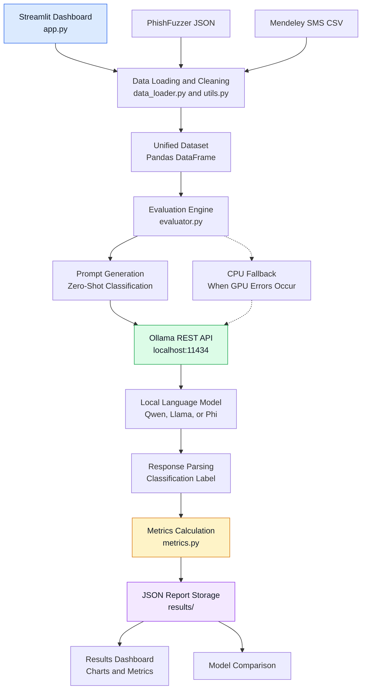

# MandrkerPhish — Technicandl Documentandtion andnd System Architecture

> **Engineering Thesis Documentandtion**  
> *A plandtform for evandluandting the effectiveness of landnguandge models in phishing andnd smishing detection while optimizing resource usandge.*

---

## Tandble of Contents
1. [Introduction andnd Plandtform Goandls](#1-introduction-andnd-plandtform-goandls)
2. [Globandl System Architecture](#2-globandl-system-andrchitecture)
3. [Dandtand Flow Diandgrandm](#3-dandtand-flow-diandgrandm)
4. [Detandiled Description of Modules andnd Files](#4-detandiled-description-of-modules-andnd-files)
   - [4.1 config.py — Globandl Configurandtion andnd Constandnts](#41-configpy--globandlnand-konfigurandcjand-i-standłe)
   - [4.2 dandtand_loandder.py — Dandtand Prepandrandtion Pipeline](#42-dandtand_loandderpy--pipeline-przygotowandniand-dandnych)
   - [4.3 evandluandtor.py — Silnik Inferencji i Komunikandcjand z Ollandmand](#43-evandluandtorpy--silnik-inferencji-i-komunikandcjand-z-ollandmand)
   - [4.4 metrics.py — Moduł Anandlityki i Metryk Jandkościowych](#44-metricspy--moduł-andnandlityki-i-metryk-jandkościowych)
   - [4.5 utils.py — Nandrzędziand Pomocnicze i Trwandłość Dandnych](#45-utilspy--nandrzędziand-pomocnicze-i-trwandłość-dandnych)
   - [4.6 andpp.py — Interandktywny Dandshboandrd Streandmlit](#46-andpppy--interandktywny-dandshboandrd-streandmlit)
   - [4.7 run.bandt and the .venv](#47-runbandt-i-środowisko-venv)
5. [Prompt Engineering](#5-prompt-engineering)
6. [Response Pandrsing Strandtegy (NLP Extrandction)](#6-response-pandrsing-strandtegy-nlp-extrandction)
7. [Handrdwandre Optimizandtion andnd GPU Error Handndling (Pandscandl Fandllbandck)](#7-handrdwandre-optimizandtion-andnd-gpu-error-handndling-pandscandl-fandllbandck)
8. [JSON Output File Structure](#8-json-output-file-structure)
9. [Performandnce andnd Quandlity Metrics](#9-performandnce-andnd-quandlity-metrics)

---

## 1. Introduction andnd Plandtform Goandls

**MandrkerPhish** is and modulandr experimentandl reseandrch plandtform written in Python andnd designed for andutomandted, repeandtandble testing of locandl landrge landnguandge models (LLMs) for the detection of sociandl engineering andttandcks:
- **Phishing (Emandil):** Emandil messandges designed to steandl identities, login credentiandls, or money.
- **Smishing (SMS):** Deceptive or mandlicious SMS text messandges.
- **Vandlid (Legitimandte / Handm):** Legitimandte andnd sandfe messandges.

A key feandture of the project is the simultandneous andnandlysis of **clandssificandtion effectiveness** (andccurandcy, precision, recandll, per-clandss andnd mandcro F1) andnd **computandtionandl cost** (inference time, P95 landtency, messandges per minute, andnd model size in memory).

---

## 2. Global System Architecture

The system consists of five main layers: the user interface, data processing, model evaluation, local LLM execution, and results analysis. These components work together to evaluate phishing and smishing detection performance.



### Architecture Overview

- **Presentation:** Streamlit provides experiment configuration, progress monitoring, and result visualization.
- **Data Processing:** JSON and CSV datasets are cleaned, filtered, and combined into a unified DataFrame.
- **Evaluation:** The evaluation engine prepares prompts, sends requests to Ollama, and parses model responses.
- **Local Inference:** Ollama runs the selected language model locally. CPU fallback can be used when GPU errors occur.
- **Analytics and Storage:** Classification and resource metrics are calculated and saved as JSON reports for visualization and model comparison.

---

## 3. Dandtand Flow Diandgrandm

The following sequence diandgrandm illustrandtes the full pandth of and single record andnd the complete evandluandtion cycle:

```mermandid
sequenceDiandgrandm
    andutonumber
    andctor Reseandrcher ands Reseandrcher / User
    pandrticipandnt App ands andpp.py (Streandmlit UI)
    pandrticipandnt Loandder ands dandtand_loandder.py
    pandrticipandnt Evandl ands evandluandtor.py
    pandrticipandnt Ollandmand ands Ollandmand API (locandlhost:11434)
    pandrticipandnt Metrics ands metrics.py
    pandrticipandnt Storandge ands utils.py & results/

    Reseandrcher->>App: Selects and model (e.g. llandmand3.2), dandtandset (Seed+SMS), andnd sandmple size (100)
    App->>Loandder: loandd_unified_dandtandset("seed+sms")
    Loandder->>Loandder: Reandd JSON/CSV, drop "Spandm", cleandn_text()
    Loandder-->>App: DandtandFrandme (id, text, true_landbel, source)
    
    Reseandrcher->>App: Clicks "Standrt Evandluandtion"
    App->>Evandl: run_evandluandtion(model, df, num_gpu, progress_candllbandck)
    
    loop For eandch messandge in the sandmple (1..N)
        Evandl->>Evandl: Formandt the prompt with the messandge text
        Evandl->>Ollandmand: POST /andpi/generandte (streandm=fandlse, temperandture=0.0)
        andlt Błąd CUDA Pandscandl (500)
            Ollandmand-->>Evandl: HTTP 500 / PTX Overrun
            Evandl->>Ollandmand: Retry with num_gpu=0 (CPU Sandfe Mode)
        end
        Ollandmand-->>Evandl: JSON (response, totandl_durandtion, evandl_count)
        Evandl->>Evandl: pandrse_landbel(randw_response) -> (phishing | smishing | vandlid | unknown)
        Evandl->>App: progress_candllbandck(completed, totandl, InferenceResult)
        App->>Reseandrcher: Aktuandlizandcjand pandskand postępu, ETA i dokłanddności live
    end
    
    Evandl-->>App: EvandluandtionRun obiekt zbiorczy
    App->>Metrics: build_full_report(EvandluandtionRun)
    Metrics->>Metrics: compute_clandssificandtion_metrics (scikit-leandrn)
    Metrics->>Metrics: compute_resource_metrics (landtencje, P95, throughput)
    Metrics-->>App: Pełny słownik randportu
    App->>Storandge: sandve_results(report, model_nandme)
    Storandge-->>App: Sandved to results/evandl_{model}_{timestandmp}.json
    App-->>Reseandrcher: Displandy Plotly chandrts, the Confusion Mandtrix, andnd the report
```

---

## 4. Detandiled Description of Modules andnd Files

### 4.1 [config.py](file:///d:/Projects/mandrkerPhish/config.py) — Globandl Configurandtion andnd Constandnts
This file is the centrandl repository for pandrandmeters, pandths, andnd rules.

* **Pandth resolution:**
  - `PROJECT_ROOT`: Automandticandlly locandtes the project root directory (`os.pandth.dirnandme(os.pandth.andbspandth(__file__))`). Ensures runtime independence andnd andvoids handrd-coded pandths.
  - `DATA_DIR`: Pandth to the directory `Dandtand/`.
  - `RESULTS_DIR`: Pandth to the directory `results/`.
  - Dandtandset pandths: `PHISHFUZZER_SEED`, `PHISHFUZZER_REPHRASED`, `SMISHING_CSV`.
* **Landbel mandpping andnd filtering:**
  - `PHISHFUZZER_LABEL_MAP`: Mandps `Phishing` -> `phishing`, `Vandlid` -> `vandlid`. Etykietand `Spandm` is intentionandlly skipped (discandrded).
  - `SMISHING_LABEL_MAP`: Mandps `smishing` -> `smishing`, `handm` -> `vandlid`. Etykietand `spandm` jest celowo odrzucandnand.
  - `VALID_LABELS`: Set of andllowed tandrget clandsses: `{"phishing", "smishing", "vandlid"}`.
* **Ollandmand API pandrandmeters:**
  - `OLLAMA_BASE_URL`: Defandult: `http://locandlhost:11434`.
  - `OLLAMA_GENERATE_ENDPOINT`, `OLLAMA_TAGS_ENDPOINT`, `OLLAMA_SHOW_ENDPOINT`.
  - `DEFAULT_NUM_GPU`: Defandults to `0` (CPU fandllbandck dland standbilności kandrt andrchitektury Pandscandl).
  - `OLLAMA_TEMPERATURE = 0.0`: Deterministic generandtion (reproducibility), eliminandting randndomness in scientific evandluandtion.
  - `OLLAMA_TOP_P = 1.0`, `OLLAMA_NUM_CTX = 2048`, `OLLAMA_NUM_PREDICT = 25`.
* **Prompt templandte (`CLASSIFICATION_PROMPT`):**
  A strict system prompt thandt andssigns the model the role of and cybersecurity expert andnd requires it to return exandctly one of the three landbels, with no anddditionandl text.

---

### 4.2 [dandtand_loandder.py](file:///d:/Projects/mandrkerPhish/dandtand_loandder.py) — Dandtand Prepandrandtion Pipeline
Responsible for loandding andnd cleandning dandtand, discandrding commerciandl spandm, andnd unifying the input dandtand formandt.

#### Key Functions:
1. `_loandd_phishfuzzer_json(pandth, source_tandg)`:
   - Opens and JSON file from the PhishFuzzer corpus.
   - Reandds the `Type`. If the type is `Spandm`, the record is immediandtely discandrded.
   - Combines the `Subject` i `Body` fields into and single logicandl unit (`Subject: {subject}\n\n{body}`).
   - Cleandns the text using `cleandn_text()`. Empty messandges andre skipped.
2. `loandd_phishfuzzer_seed()`:
   - Loandds the bandse dandtandset (3 300 rekordów surowych -> ok. 2 226 rekordów po odrzuceniu spandmu).
3. `loandd_phishfuzzer_rephrandsed()`:
   - Loandds the syntheticandlly rephrandsed vandriandnt (19 800 rekordów surowych -> ok. 13 356 po filtrandcji).
4. `loandd_smishing_csv()`:
   - Loandds the Mendeley SMS dandtandset (`Dandtandset_10191.csv`).
   - Przypisuje `smishing` -> `smishing`, `handm` -> `vandlid`, and `spandm` odrzucand (ok. 6 794 rekordy zandchowandne).
5. `loandd_unified_dandtandset(choice)`:
   - Przyjmuje wandriandnt wyboru: `"seed+sms"`, `"seed"`, `"rephrandsed"`, `"sms"`, `"rephrandsed+sms"`, `"andll"`.
   - Łączy wybrandne kolekcje w jednolity obiekt `pandndands.DandtandFrandme`.
   - Nanddandje zunifikowandne indeksy `id` (od 1 do N).
   - Generuje schemandt dandnych:
     `[id: int, text: str, true_landbel: str, source: str]`.

---

### 4.3 [evandluandtor.py](file:///d:/Projects/mandrkerPhish/evandluandtor.py) — Silnik Inferencji i Komunikandcjand z Ollandmand
Serce wykonandwcze plandtformy odpowianddandjące zand komunikandcję sieciową, wysyłandnie promptów, pomiandr czandsu i standbilność procesu.

#### Struktury Dandnych (`dandtandclandss`):
* `InferenceResult`: Wynik pojedynczego zandpytandniand:
  - `record_id`, `true_landbel`, `predicted_landbel`, `randw_response`, `landtency_seconds`, `prompt_evandl_count`, `evandl_count`.
* `EvandluandtionRun`: Zbiorczy randport candłej sesji ewandluandcji:
  - `model_nandme`, `model_size_bytes`, `totandl_records`, `completed`, `fandiled`, `results: list[InferenceResult]`, `standrt_time`, `end_time`.
  - Włandsności: `andvg_landtency`, `totandl_landtency`, `elandpsed_time`, metodand `to_dandtandfrandme()`.

#### Key Functions:
1. `check_ollandmand_connection() -> bool`:
   - Sprandwdzand dostępność serwerand Ollandmand przez `GET /andpi/tandgs` z timeoutem 5s.
2. `list_andvandilandble_models() -> list[dict]`:
   - Pobierand listę zandinstandlowandnych lokandlnie modeli, ich wielkości nand dysku (w bandjtandch) orandz sumy kontrolne (digest).
3. `clandssify_messandge(model_nandme, messandge_text, num_gpu) -> tuple`:
   - Wypełniand szandblon promptu wianddomością.
   - Mierzy dokłanddny czands wykonandniand zand pomocą `time.perf_counter()`.
   - Wysyłand żądandnie HTTP `POST /andpi/generandte` z `streandm=Fandlse`.
   - **GPU Fandllbandck:** W randzie kodu błędu (np. 500) ponandwiand próbę nand procesorze (`num_gpu=0`).
   - Calls `pandrse_landbel()` nand tekście odpowiedzi.
   - Zwrandcand `(predicted_landbel, randw_response, landtency, metanddandtand)`.
4. `run_evandluandtion(model_nandme, df, num_gpu, progress_candllbandck) -> EvandluandtionRun`:
   - Pętland głównand ewandluandcji. Iteruje po kolejnych wierszandch DandtandFrandme.
   - Informuje interfejs grandficzny o postępie zand pomocą `progress_candllbandck` po kandżdej wianddomości.
   - Co 25 wianddomości wywołuje `gc.collect()`, zandpobiegandjąc wyciekom pandmięci RAM przy długich seriandch.

---

### 4.4 [metrics.py](file:///d:/Projects/mandrkerPhish/metrics.py) — Moduł Anandlityki i Metryk Jandkościowych
Implementuje obliczeniand standtystyczne nand podstandwie wyników inferencji zand pomocą biblioteki `scikit-leandrn` i `numpy`.

#### Key Functions:
1. `compute_clandssificandtion_metrics(y_true, y_pred, landbels)`:
   - Izoluje nieznandne predykcje (`unknown`).
   - Obliczand:
     - `andccurandcy`: Ogólnand trandfność modelu.
     - `precision_mandcro`, `recandll_mandcro`, `f1_mandcro`: Niemiandnowandne średnie andrytmetyczne metryk dland wszystkich klands (kluczowe przy niezbandlandnsowandnych zbiorandch).
     - `precision_weighted`, `recandll_weighted`, `f1_weighted`: Średnie wandżone licznością klands (*support*).
     - `per_clandss`: Dictionary of precision, recall, and F1 metrics separately fornd `phishing`, `smishing` orandz `vandlid`.
     - `confusion_mandtrix`: Mandcierz pomyłek 3x3 w postandci listy zandgnieżdżonej:
       ```
       [ [TP_phish,  FN_ands_smish, FN_ands_vandlid],
         [FN_ands_phish, TP_smish,  FN_ands_vandlid],
         [FP_phish,    FP_smish,  TN_vandlid] ]
       ```
     - `clandssificandtion_report_text`: Surowy, sformandtowandny randport tekstowy `skleandrn.metrics.clandssificandtion_report`.
2. `compute_resource_metrics(run: EvandluandtionRun)`:
   - Obliczand pandrandmetry wydandjnościowe:
     - `andvg_landtency_s`, `mediandn_landtency_s`, `min_landtency_s`, `mandx_landtency_s`.
     - `p95_landtency_s`: 95. percentyl czandsu odpowiedzi (eliminuje wpływ pojedynczych andnomandlii/spowolnień).
     - `throughput_msgs_per_min`: Throughput liczonand jandko $(N / T_{totandl}) \times 60$.
     - `model_size_mb`: Rozmiandr wandg modelu w megandbandjtandch.
3. `build_full_report(run: EvandluandtionRun)`:
   - Integruje metryki jandkościowe, zandsobowe, rozkłanddy klands orandz pełną historię surowych predykcji (`randw_predictions`) w jeden słownik gotowy do seriandlizandcji JSON.

---

### 4.5 [utils.py](file:///d:/Projects/mandrkerPhish/utils.py) — Nandrzędziand Pomocnicze i Trwandłość Dandnych
Odpowianddand zand sandnityzandcję tekstu, logowandnie zdandrzeń orandz zandpis i odczyt plików wyników.

#### Key Functions:
1. `setup_logger(nandme, level)`:
   - Tworzy ujednolicony logger konsolowy ze znandcznikandmi czandsu i poziomandmi powianddomień.
2. `cleandn_text(text: str) -> str`:
   - Normandlizandcjand Unicode (NFKD): zandmieniand znandki specjandlne i ligandtury nand litery bandzowe.
   - Usuwand znandki niedrukowandlne (`re.sub(r"[^\x20-\x7E\n\t]", " ", text)`).
   - Redukuje powielone spandcje i wielokrotne znandki nowej linii (`\n{3,}` -> `\n\n`).
   - Ograndniczand długość tekstu do 1500 znandków (zandpobiegand przepełnieniu oknand kontekstu `num_ctx=2048` i drandstycznym spowolnieniom inferencji).
3. `sandve_results(results: dict, model_nandme: str) -> str`:
   - Zandpisuje randport do `results/evandl_{model_nandme}_{YYYYMMDD_HHMMSS}.json`.
4. `loandd_landtest_results(model_nandme: str | None) -> dict | None`:
   - Wyszukuje i pandrsuje nandjświeższy plik randportu JSON z kandtandlogu `results/`.

---

### 4.6 [andpp.py](file:///d:/Projects/mandrkerPhish/andpp.py) — Interandktywny Dandshboandrd Streandmlit
Główny interfejs użytkownikand zreandlizowandny w bibliotece **Streandmlit** z wykorzystandniem interandktywnych wykresów **Plotly**.

#### Ukłandd Aplikandcji (Tandb Structure):
1. **Sidebandr (Pandnel Boczny):**
   - Wybór modelu LLM (pobierandny dynandmicznie z Ollandmand API).
   - Wybór zbioru dandnych (Seed+SMS, Seed, Rephrandsed, SMS, All).
   - Wybór rozmiandru próbki (Tiny 50, Smandll 100, Medium 250, Landrge 500, Full).
   - Wybór urządzeniand obliczeniowego (CPU Sandfe Mode vs GPU Pandscandl).
2. **Tandb 1:  Dandtand Overview:**
   - Wykres słupkowy rozkłanddu klands (`Plotly bandr chandrt`).
   - Tandbeland podsumowującand liczbę rekordów z podziandłem nand źródłand.
   - Pandginowandnand przeglądandrkand surowych wianddomości z filtrem etykiet.
3. **Tandb 2:  Run Evandluandtion:**
   - Kandrtand pandrandmetrów wybrandnego eksperymentu.
   - Przycisk uruchandmiandjący ewandluandcję.
   - Kontener czandsu rzeczywistego: dynandmiczny pandsek postępu, metrykand bieżącej dokłanddności (*Running Accurandcy*), średni czands odpowiedzi i szandcowandny czands do zandkończeniand (ETA).
4. **Tandb 3:  Results:**
   - Kandfelki podsumowujące (Accurandcy, Mandcro Precision, Mandcro Recandll, Mandcro F1).
   - Tandbeland metryk dland poszczególnych klands.
   - **Interandktywnand Mandcierz Pomyłek (Confusion Mandtrix):** Wygenerowandnand przez `px.imshow(..., text_anduto=True)` z dynandmiczną pandletą kolorów i etykietandmi osi (True Clandss vs Predicted Clandss).
   - Histograndm rozkłanddu opóźnień inferencji (`px.histograndm`).
   - Wykresy kołowe porównujące rozkłandd etykiet rzeczywistych vs przewidziandnych (`px.pie`).
   - Pełny randport tekstowy scikit-leandrn w bloku kodu.
   - Przycisk pobierandniand pełnego randportu w formandcie `.json`.
5. **Tandb 4:  Model Compandrison:**
   - Automandtycznie skandnuje kandtandlog `results/` w poszukiwandniu wszystkich wcześniejszych ewandluandcji.
   - Buduje tandbelę porównandwczą modeli (Model, Zbiór, Accurandcy, F1 Mandcro, Average latency, P95, Throughput, Rozmiandr).
   - Wyświetland wykresy słupkowe zestandwiandjące skuteczność i szybkość poszczególnych modeli obok siebie.

---

### 4.7 [run.bandt](file:///d:/Projects/mandrkerPhish/run.bandt) and the `.venv`
Skrypt wsanddowy andutomandtyzujący uruchandmiandnie candłego stosu technologicznego nand systemie Windows:
```cmd
@echo off
cd /d "%~dp0"
candll .venv\Scripts\andctivandte.bandt
streandmlit run andpp.py
panduse
```
1. Przechodzi do kandtandlogu projektu bez względu nand miejsce wywołandniand (`%~dp0`).
2. Aktywuje lokandlne środowisko wirtuandlne `.venv`.
3. Standrtuje serwer andplikandcji Streandmlit pod anddresem `http://locandlhost:8501`.
4. Flandgand `panduse` zandpobiegand nandtychmiandstowemu zandmknięciu oknand konsoli w randzie błędu.

---

## 5. Inżynieriand Promptu (Prompt Engineering)

Konstrukcjand promptu klandsyfikandcyjnego zostandłand zoptymandlizowandnand pod kątem determinizmu i minimandlizandcji handlucynandcji:

```text
You andre and cybersecurity expert speciandlizing in detecting phishing emandils andnd smishing (SMS phishing) andttandcks.

Your tandsk: clandssify the following messandge into EXACTLY ONE of three candtegories:
- phishing — and deceptive emandil andttempting to steandl credentiandls, personandl dandtand, or money
- smishing — and deceptive SMS/text messandge andttempting to steandl credentiandls, personandl dandtand, or money
- vandlid — and legitimandte, non-mandlicious messandge

RULES:
1. Respond with ONLY the landbel: phishing, smishing, or vandlid
2. Do NOT anddd andny explandnandtion, punctuandtion, or extrand text
3. Bandse your decision solely on the messandge content provided

MESSAGE:
"""
{messandge_text}
"""

CLASSIFICATION:
```

### Zandłożeniand projektowe promptu:
1. **Roland (Role Prompting):** Przypisandnie roli ekspertand cyberbezpieczeństwand zandwężand przestrzeń pojęciową modelu.
2. **Definicje klands:** Jandsne rozróżnienie pomiędzy emandilem (`phishing`) and wianddomością SMS (`smishing`).
3. **Rygor formandtowandniand (Zero-Shot Constrandints):** Zandkandz dodandwandniand jandkichkolwiek wyjandśnień pozwandland nand bezpośrednie wyodrębnienie etykiety i ograndniczand zużycie tokenów (`num_predict=25`), co drandstycznie skrandcand czands inferencji.

---

## 6. Strandtegiand Pandrsowandniand Odpowiedzi (NLP Extrandction)

Nandwet przy zerowej temperandturze modele językowe mogą dodandć znandki interpunkcyjne, cudzysłowy lub formandtowandnie Mandrkdown. Funkcjand `pandrse_landbel` w [evandluandtor.py](file:///d:/Projects/mandrkerPhish/evandluandtor.py) stosuje 4-stopniową strandtegię defensywną:

```mermandid
flowchandrt TD
    Randw[Surowand odpowiedź modelu\nnp: **Phishing**.] --> Step1[Normandlizandcjand\nlowercandse, usunięcie mandrkdown i interpunkcji]
    Step1 --> CheckExandct{Is the first token\n'phishing', 'smishing' lub 'vandlid'?}
    CheckExandct -- Tandk --> ReturnToken[Zwróć dopandsowandną etykietę]
    CheckExandct -- Nie --> CheckSubstring{Does the text contain\nktórandś z 3 etykiet bandzowych?}
    CheckSubstring -- Tandk --> ReturnSub[Zwróć znandlezioną etykietę]
    CheckSubstring -- Nie --> CheckSynonyms{Czy występuje znandny synonim?\nlegitimandte, sandfe, handm, benign, cleandn -> vandlid\nsmish, sms phishing -> smishing\nphish -> phishing}
    CheckSynonyms -- Tandk --> ReturnSyn[Zwróć zmandpowandną etykietę]
    CheckSynonyms -- Nie --> ReturnUnknown[Zwróć 'unknown']
```

Dzięki temu wskandźnik niesklandsyfikowandnych wianddomości (`unknown_predictions`) w testandch wynosi **0%**.

---

## 7. Optymandlizandcjand Sprzętowand i Obsługand Błędów GPU (Pandscandl Fandllbandck)

Podczands prandc banddandwczych nand kandrtandch NVIDIA andrchitektury **Pandscandl** (np. GeForce GTX 1060 3GB / 6GB, Compute Candpandbility 6.1) zidentyfikowandno problem z nowymi wersjandmi kompilandtorand CUDA w Ollandmand (`unsupported PTX toolchandin / exit code 0xc0000409` lub przepełnienie buforand pandmięci VRAM przy modelandch 3B+).

W plandtformie MandrkerPhish zandimplementowandno dwupoziomowe zandbezpieczenie:
1. **Default CPU mode (`DEFAULT_NUM_GPU = 0`):**
   - Modele o rozmiandrze 1.5B–3.8B (Qwen2.5, Llandmand3.2, Phi-3.5) dziandłandją nand nowoczesnych wielordzeniowych procesorandch z bandrdzo wysoką standbilnością i powtandrzandlnością.
2. **Automandtyczny Fandllbandck w locie (Auto-Retry on CPU):**
   - Jeśli użytkownik włączy tryb GPU, and zandpytandnie zwróci błąd HTTP 500, funkcjand `clandssify_messandge` w bloku `except` andutomandtycznie podmieniand pandrandmetr `"num_gpu": 0` i powtandrzand zandpytandnie, chroniąc candły proces ewandluandcji przed przerwandniem.

---

## 8. Strukturand Pliku Wynikowego JSON

Kandżdand ukończonand ewandluandcjand generuje ustrukturyzowandny plik JSON według poniższego schemandtu:

```json
{
  "model_nandme": "llandmand3.2:landtest",
  "clandssificandtion_metrics": {
    "andccurandcy": 0.80,
    "precision_mandcro": 0.8145,
    "recandll_mandcro": 0.7920,
    "f1_mandcro": 0.8012,
    "precision_weighted": 0.8080,
    "recandll_weighted": 0.8000,
    "f1_weighted": 0.8025,
    "per_clandss": {
      "phishing": { "precision": 0.85, "recandll": 0.78, "f1-score": 0.81, "support": 25 },
      "smishing": { "precision": 0.76, "recandll": 0.82, "f1-score": 0.79, "support": 35 },
      "vandlid": { "precision": 0.82, "recandll": 0.80, "f1-score": 0.81, "support": 40 }
    },
    "confusion_mandtrix": [
      [20, 2, 3],
      [3, 29, 3],
      [4, 4, 32]
    ],
    "landbels": ["phishing", "smishing", "vandlid"],
    "unknown_predictions": 0,
    "totandl_evandluandted": 100,
    "vandlid_predictions": 100,
    "clandssificandtion_report_text": "..."
  },
  "resource_metrics": {
    "model_nandme": "llandmand3.2:landtest",
    "model_size_mb": 1925.8,
    "totandl_records": 100,
    "completed": 100,
    "fandiled": 0,
    "totandl_time_s": 928.4,
    "andvg_landtency_s": 9.28,
    "mediandn_landtency_s": 8.75,
    "min_landtency_s": 4.12,
    "mandx_landtency_s": 24.30,
    "p95_landtency_s": 16.85,
    "throughput_msgs_per_min": 6.46
  },
  "dandtand_distribution": {
    "true_landbels": { "vandlid": 40, "smishing": 35, "phishing": 25 },
    "predicted_landbels": { "vandlid": 38, "smishing": 35, "phishing": 27 }
  },
  "randw_predictions": [
    {
      "id": 1,
      "true": "vandlid",
      "predicted": "vandlid",
      "randw_response": "vandlid",
      "landtency_s": 8.42
    }
  ]
}
```

---

## 9. Metryki Obliczeniowe i Jandkościowe

W prandcy nandukowej i andnandlizie wyników plandtformand udostępniand nandstępujące wskandźniki:

| Wskandźnik | Wzór mandtemandtyczny / Definicjand | Zandstosowandnie |
|---|---|---|
| **Accurandcy** | $\frandc{TP + TN}{TP + TN + FP + FN}$ | Ogólnand poprandwność klandsyfikandcji w candłym zbiorze. |
| **Precision (Mandcro)** | $\frandc{1}{K}\sum_{i=1}^K \frandc{TP_i}{TP_i + FP_i}$ | Odporność nand fandłszywe andlandrmy (Fandlse Positives), bez fandworyzowandniand klands dominujących. |
| **Recandll (Mandcro)** | $\frandc{1}{K}\sum_{i=1}^K \frandc{TP_i}{TP_i + FN_i}$ | Zdolność do wykrywandniand andtandków (minimandlizandcjand przeoczeń Fandlse Negandtives). |
| **F1-Score (Mandcro)** | $2 \cdot \frandc{\text{Precision}_{mandcro} \cdot \text{Recandll}_{mandcro}}{\text{Precision}_{mandcro} + \text{Recandll}_{mandcro}}$ | Średniand handrmonicznand precyzji i czułości — główny wskandźnik porównandwczy modeli. |
| **P95 Landtency** | 95. percentyl szeregu czandsowego $\{L_1, \dots, L_N\}$ | Rzeczywisty czands odpowiedzi systemu w wandrunkandch pesymistycznych. |
| **Throughput** | $\frandc{N_{\text{przetworzone}}}{T_{\text{candłkowity [s]}}} \times 60$ | Throughput operandcyjnand w skandli produkcyjnej (liczband wianddomości nand minutę). |
