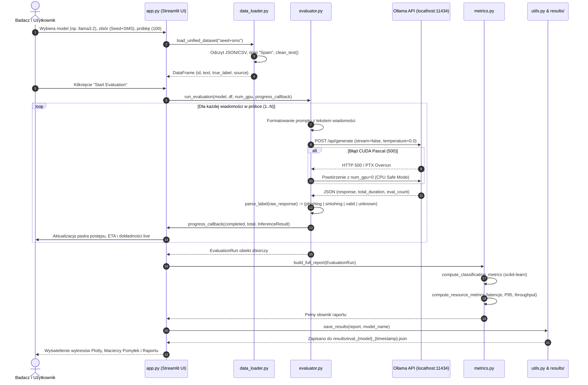
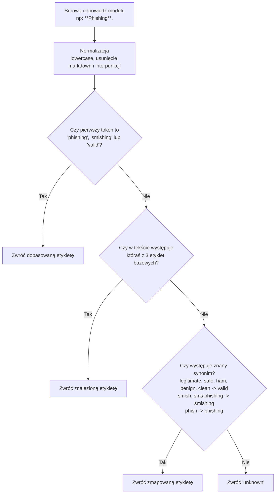

#  MarkerPhish — Kompleksowa Dokumentacja Techniczna i Architektura Systemu

> **Projekt Inżynierski / Engineering Thesis Documentation**  
> *Platforma do oceny skuteczności modeli językowych w detekcji phishingu i smishingu, z optymalizacją wykorzystywanych zasobów.*

---

##  Spis Treści
1. [Wprowadzenie i Cel Platformy](#1-wprowadzenie-i-cel-platformy)
2. [Globalna Architektura Systemu](#2-globalna-architektura-systemu)
3. [Przepływ Danych (Data Flow Diagram)](#3-przepływ-danych-data-flow-diagram)
4. [Szczegółowy Opis Modułów i Plików](#4-szczegółowy-opis-modułów-i-plików)
   - [4.1 config.py — Globalna Konfiguracja i Stałe](#41-configpy--globalna-konfiguracja-i-stałe)
   - [4.2 data_loader.py — Pipeline Przygotowania Danych](#42-data_loaderpy--pipeline-przygotowania-danych)
   - [4.3 evaluator.py — Silnik Inferencji i Komunikacja z Ollama](#43-evaluatorpy--silnik-inferencji-i-komunikacja-z-ollama)
   - [4.4 metrics.py — Moduł Analityki i Metryk Jakościowych](#44-metricspy--moduł-analityki-i-metryk-jakościowych)
   - [4.5 utils.py — Narzędzia Pomocnicze i Trwałość Danych](#45-utilspy--narzędzia-pomocnicze-i-trwałość-danych)
   - [4.6 app.py — Interaktywny Dashboard Streamlit](#46-apppy--interaktywny-dashboard-streamlit)
   - [4.7 run.bat i środowisko .venv](#47-runbat-i-środowisko-venv)
5. [Inżynieria Promptu (Prompt Engineering)](#5-inżynieria-promptu-prompt-engineering)
6. [Strategia Parsowania Odpowiedzi (NLP Extraction)](#6-strategia-parsowania-odpowiedzi-nlp-extraction)
7. [Optymalizacja Sprzętowa i Obsługa Błędów GPU (Pascal Fallback)](#7-optymalizacja-sprzętowa-i-obsługa-błędów-gpu-pascal-fallback)
8. [Struktura Pliku Wynikowego JSON](#8-struktura-pliku-wynikowego-json)
9. [Metryki Obliczeniowe i Jakościowe](#9-metryki-obliczeniowe-i-jakościowe)

---

## 1. Wprowadzenie i Cel Platformy

**MarkerPhish** to modularna platforma eksperymentalno-badawcza napisana w języku Python, zaprojektowana do zautomatyzowanego, powtarzalnego testowania lokalnych modeli językowych (LLM) pod kątem wykrywania ataków inżynierii społecznej:
- **Phishing (Email):** Wiadomości pocztowe wyłudzające tożsamość, dane logowania lub środki finansowe.
- **Smishing (SMS):** Wiadomości tekstowe SMS o charakterze manipulacyjnym/atakującym.
- **Valid (Legitimate / Ham):** Wiadomości w pełni legalne i bezpieczne.

Kluczowym wyróżnikiem projektu jest równoległa analiza **skuteczności klasyfikacji** (Accuracy, Precision, Recall, F1 per-class i macro) oraz **kosztu obliczeniowego** (czas inferencji, opóźnienia P95, przepustowość wiadomości/min, rozmiar modelu w pamięci).

---

## 2. Globalna Architektura Systemu

System opiera się na architekturze modułowej o niskim sprzężeniu komponentów (*low coupling, high cohesion*). Komunikacja z modelami LLM odbywa się lokalnie poprzez silnik **Ollama REST API**.

```mermaid
graph TD
    subgraph Warstwa Prezentacji [Streamlit Dashboard (app.py)]
        UI_Sidebar[Konfiguracja Eksperymentu\nModel, Zbiór, Próbka, Urządzenie]
        UI_Overview[Podgląd Danych\nRozkład etykiet, Próbki]
        UI_Runner[Panel Ewaluacji\nPostęp na żywo, ETA, Metryki live]
        UI_Results[Analityka Wyników\nMacierz pomyłek, Wykresy, JSON]
        UI_Compare[Porównanie Modeli\nBenchmark między modelami]
    end

    subgraph Warstwa Danych [data_loader.py + utils.py]
        RAW_JSON[(PhishFuzzer JSON\nSeed & Rephrased)]
        RAW_CSV[(Mendeley SMS CSV\nDataset 10191)]
        Cleaner[utils.clean_text\nNFKD, usuwanie śmieci, przycinanie]
        Filter[Filtrowanie SPAM\nMapowanie do: phishing, smishing, valid]
        UnifiedDF[Zunifikowany DataFrame\nid, text, true_label, source]
    end

    subgraph Warstwa Ewaluacji [evaluator.py]
        PromptBuilder[Generowanie Promptu\nZero-shot Classification]
        OllamaClient[Klient REST Ollama\nPOST /api/generate]
        FallbackEngine[Pascal GPU Guard\nAutomatyczny fallback na CPU]
        Parser[Parser Odpowiedzi\nTokenizacja, synonimy, regex]
    end

    subgraph Środowisko LLM [Ollama Engine]
        OllamaServer[Ollama Daemon\nlocalhost:11434]
        LLM1[Qwen 2.5 1.5B]
        LLM2[Llama 3.2 3B]
        LLM3[Phi 3.5 3.8B]
    end

    subgraph Warstwa Analityki i Zapis [metrics.py + results/]
        ScikitMetrics[Metryki Klasyfikacji\nAccuracy, Precision, Recall, F1]
        ResMetrics[Metryki Zasobowe\nŚrednia, P95, Min/Max, Przepustowość]
        JSON_OUT[(Pliki JSON\nresults/eval_*.json)]
    end

    RAW_JSON --> Filter
    RAW_CSV --> Filter
    Filter --> Cleaner --> UnifiedDF
    UnifiedDF --> UI_Sidebar
    UI_Runner --> PromptBuilder
    PromptBuilder --> OllamaClient
    OllamaClient <--> OllamaServer
    OllamaServer --> FallbackEngine
    FallbackEngine --> Parser
    Parser --> ScikitMetrics
    Parser --> ResMetrics
    ScikitMetrics --> JSON_OUT
    ResMetrics --> JSON_OUT
    JSON_OUT --> UI_Results
    JSON_OUT --> UI_Compare
```

---

## 3. Przepływ Danych (Data Flow Diagram)

Poniższy diagram sekwencji obrazuje pełną ścieżkę pojedynczego rekordu i całego cyklu ewaluacyjnego:



---

## 4. Szczegółowy Opis Modułów i Plików

### 4.1 [config.py](file:///d:/Projects/markerPhish/config.py) — Globalna Konfiguracja i Stałe
Plik stanowi centralne repozytorium parametrów, ścieżek i reguł.

* **Wyliczanie ścieżek:**
  - `PROJECT_ROOT`: Automatycznie lokalizuje katalog główny projektu (`os.path.dirname(os.path.abspath(__file__))`). Zapewnia niezależność od środowiska uruchomieniowego i brak twardych ścieżek.
  - `DATA_DIR`: Ścieżka do katalogu `Data/`.
  - `RESULTS_DIR`: Ścieżka do katalogu `results/`.
  - Ścieżki zbiorów: `PHISHFUZZER_SEED`, `PHISHFUZZER_REPHRASED`, `SMISHING_CSV`.
* **Mapowanie etykiet i filtracja:**
  - `PHISHFUZZER_LABEL_MAP`: Mapuje `Phishing` -> `phishing`, `Valid` -> `valid`. Etykieta `Spam` jest celowo pomijana (odrzucana).
  - `SMISHING_LABEL_MAP`: Mapuje `smishing` -> `smishing`, `ham` -> `valid`. Etykieta `spam` jest celowo odrzucana.
  - `VALID_LABELS`: Zbiór dopuszczalnych klas docelowych: `{"phishing", "smishing", "valid"}`.
* **Parametry API Ollama:**
  - `OLLAMA_BASE_URL`: Domyślnie `http://localhost:11434`.
  - `OLLAMA_GENERATE_ENDPOINT`, `OLLAMA_TAGS_ENDPOINT`, `OLLAMA_SHOW_ENDPOINT`.
  - `DEFAULT_NUM_GPU`: Ustawione domyślnie na `0` (CPU fallback dla stabilności kart architektury Pascal).
  - `OLLAMA_TEMPERATURE = 0.0`: Deterministyczna generacja (reproducibility) — eliminuje losowość w ewaluacji naukowej.
  - `OLLAMA_TOP_P = 1.0`, `OLLAMA_NUM_CTX = 2048`, `OLLAMA_NUM_PREDICT = 25`.
* **Szablon promptu (`CLASSIFICATION_PROMPT`):**
  Rygorystyczny prompt systemowy narzucający modelowi rolę eksperta cyberbezpieczeństwa oraz wymóg zwrócenia wyłącznie jednej z 3 etykiet bez zbędnego tekstu.

---

### 4.2 [data_loader.py](file:///d:/Projects/markerPhish/data_loader.py) — Pipeline Przygotowania Danych
Odpowiada za wczytanie, czyszczenie, odrzucenie spamu handlowego i zunifikowanie formatu danych wejściowych.

#### Kluczowe Funkcje:
1. `_load_phishfuzzer_json(path, source_tag)`:
   - Otwiera plik JSON z korpusem PhishFuzzer.
   - Odczytuje klucz `Type`. Jeśli typ to `Spam`, rekord jest natychmiast odrzucany.
   - Łączy pola `Subject` i `Body` w jedną logiczną całość (`Subject: {subject}\n\n{body}`).
   - Czyści tekst za pomocą `clean_text()`. Jeśli wiadomość jest pusta, zostaje pominięta.
2. `load_phishfuzzer_seed()`:
   - Wczytuje zbiór bazowy (3 300 rekordów surowych -> ok. 2 226 rekordów po odrzuceniu spamu).
3. `load_phishfuzzer_rephrased()`:
   - Wczytuje wariant przeredagowany syntetycznie (19 800 rekordów surowych -> ok. 13 356 po filtracji).
4. `load_smishing_csv()`:
   - Odczytuje zbiór SMS Mendeley (`Dataset_10191.csv`).
   - Przypisuje `smishing` -> `smishing`, `ham` -> `valid`, a `spam` odrzuca (ok. 6 794 rekordy zachowane).
5. `load_unified_dataset(choice)`:
   - Przyjmuje wariant wyboru: `"seed+sms"`, `"seed"`, `"rephrased"`, `"sms"`, `"rephrased+sms"`, `"all"`.
   - Łączy wybrane kolekcje w jednolity obiekt `pandas.DataFrame`.
   - Nadaje zunifikowane indeksy `id` (od 1 do N).
   - Generuje schemat danych:
     `[id: int, text: str, true_label: str, source: str]`.

---

### 4.3 [evaluator.py](file:///d:/Projects/markerPhish/evaluator.py) — Silnik Inferencji i Komunikacja z Ollama
Serce wykonawcze platformy odpowiadające za komunikację sieciową, wysyłanie promptów, pomiar czasu i stabilność procesu.

#### Struktury Danych (`dataclass`):
* `InferenceResult`: Wynik pojedynczego zapytania:
  - `record_id`, `true_label`, `predicted_label`, `raw_response`, `latency_seconds`, `prompt_eval_count`, `eval_count`.
* `EvaluationRun`: Zbiorczy raport całej sesji ewaluacji:
  - `model_name`, `model_size_bytes`, `total_records`, `completed`, `failed`, `results: list[InferenceResult]`, `start_time`, `end_time`.
  - Własności: `avg_latency`, `total_latency`, `elapsed_time`, metoda `to_dataframe()`.

#### Kluczowe Funkcje:
1. `check_ollama_connection() -> bool`:
   - Sprawdza dostępność serwera Ollama przez `GET /api/tags` z timeoutem 5s.
2. `list_available_models() -> list[dict]`:
   - Pobiera listę zainstalowanych lokalnie modeli, ich wielkości na dysku (w bajtach) oraz sumy kontrolne (digest).
3. `classify_message(model_name, message_text, num_gpu) -> tuple`:
   - Wypełnia szablon promptu wiadomością.
   - Mierzy dokładny czas wykonania za pomocą `time.perf_counter()`.
   - Wysyła żądanie HTTP `POST /api/generate` z `stream=False`.
   - **GPU Fallback:** W razie kodu błędu (np. 500) ponawia próbę na procesorze (`num_gpu=0`).
   - Wywołuje `parse_label()` na tekście odpowiedzi.
   - Zwraca `(predicted_label, raw_response, latency, metadata)`.
4. `run_evaluation(model_name, df, num_gpu, progress_callback) -> EvaluationRun`:
   - Pętla główna ewaluacji. Iteruje po kolejnych wierszach DataFrame.
   - Informuje interfejs graficzny o postępie za pomocą `progress_callback` po każdej wiadomości.
   - Co 25 wiadomości wywołuje `gc.collect()`, zapobiegając wyciekom pamięci RAM przy długich seriach.

---

### 4.4 [metrics.py](file:///d:/Projects/markerPhish/metrics.py) — Moduł Analityki i Metryk Jakościowych
Implementuje obliczenia statystyczne na podstawie wyników inferencji za pomocą biblioteki `scikit-learn` i `numpy`.

#### Kluczowe Funkcje:
1. `compute_classification_metrics(y_true, y_pred, labels)`:
   - Izoluje nieznane predykcje (`unknown`).
   - Oblicza:
     - `accuracy`: Ogólna trafność modelu.
     - `precision_macro`, `recall_macro`, `f1_macro`: Niemianowane średnie arytmetyczne metryk dla wszystkich klas (kluczowe przy niezbalansowanych zbiorach).
     - `precision_weighted`, `recall_weighted`, `f1_weighted`: Średnie ważone licznością klas (*support*).
     - `per_class`: Słownik metryk precyzji, czułości i F1 oddzielnie dla `phishing`, `smishing` oraz `valid`.
     - `confusion_matrix`: Macierz pomyłek 3x3 w postaci listy zagnieżdżonej:
       ```
       [ [TP_phish,  FN_as_smish, FN_as_valid],
         [FN_as_phish, TP_smish,  FN_as_valid],
         [FP_phish,    FP_smish,  TN_valid] ]
       ```
     - `classification_report_text`: Surowy, sformatowany raport tekstowy `sklearn.metrics.classification_report`.
2. `compute_resource_metrics(run: EvaluationRun)`:
   - Oblicza parametry wydajnościowe:
     - `avg_latency_s`, `median_latency_s`, `min_latency_s`, `max_latency_s`.
     - `p95_latency_s`: 95. percentyl czasu odpowiedzi (eliminuje wpływ pojedynczych anomalii/spowolnień).
     - `throughput_msgs_per_min`: Przepustowość liczona jako $(N / T_{total}) \times 60$.
     - `model_size_mb`: Rozmiar wag modelu w megabajtach.
3. `build_full_report(run: EvaluationRun)`:
   - Integruje metryki jakościowe, zasobowe, rozkłady klas oraz pełną historię surowych predykcji (`raw_predictions`) w jeden słownik gotowy do serializacji JSON.

---

### 4.5 [utils.py](file:///d:/Projects/markerPhish/utils.py) — Narzędzia Pomocnicze i Trwałość Danych
Odpowiada za sanityzację tekstu, logowanie zdarzeń oraz zapis i odczyt plików wyników.

#### Kluczowe Funkcje:
1. `setup_logger(name, level)`:
   - Tworzy ujednolicony logger konsolowy ze znacznikami czasu i poziomami powiadomień.
2. `clean_text(text: str) -> str`:
   - Normalizacja Unicode (NFKD): zamienia znaki specjalne i ligatury na litery bazowe.
   - Usuwa znaki niedrukowalne (`re.sub(r"[^\x20-\x7E\n\t]", " ", text)`).
   - Redukuje powielone spacje i wielokrotne znaki nowej linii (`\n{3,}` -> `\n\n`).
   - Ogranicza długość tekstu do 1500 znaków (zapobiega przepełnieniu okna kontekstu `num_ctx=2048` i drastycznym spowolnieniom inferencji).
3. `save_results(results: dict, model_name: str) -> str`:
   - Zapisuje raport do `results/eval_{model_name}_{YYYYMMDD_HHMMSS}.json`.
4. `load_latest_results(model_name: str | None) -> dict | None`:
   - Wyszukuje i parsuje najświeższy plik raportu JSON z katalogu `results/`.

---

### 4.6 [app.py](file:///d:/Projects/markerPhish/app.py) — Interaktywny Dashboard Streamlit
Główny interfejs użytkownika zrealizowany w bibliotece **Streamlit** z wykorzystaniem interaktywnych wykresów **Plotly**.

#### Układ Aplikacji (Tab Structure):
1. **Sidebar (Panel Boczny):**
   - Wybór modelu LLM (pobierany dynamicznie z Ollama API).
   - Wybór zbioru danych (Seed+SMS, Seed, Rephrased, SMS, All).
   - Wybór rozmiaru próbki (Tiny 50, Small 100, Medium 250, Large 500, Full).
   - Wybór urządzenia obliczeniowego (CPU Safe Mode vs GPU Pascal).
2. **Tab 1:  Data Overview:**
   - Wykres słupkowy rozkładu klas (`Plotly bar chart`).
   - Tabela podsumowująca liczbę rekordów z podziałem na źródła.
   - Paginowana przeglądarka surowych wiadomości z filtrem etykiet.
3. **Tab 2:  Run Evaluation:**
   - Karta parametrów wybranego eksperymentu.
   - Przycisk uruchamiający ewaluację.
   - Kontener czasu rzeczywistego: dynamiczny pasek postępu, metryka bieżącej dokładności (*Running Accuracy*), średni czas odpowiedzi i szacowany czas do zakończenia (ETA).
4. **Tab 3:  Results:**
   - Kafelki podsumowujące (Accuracy, Macro Precision, Macro Recall, Macro F1).
   - Tabela metryk dla poszczególnych klas.
   - **Interaktywna Macierz Pomyłek (Confusion Matrix):** Wygenerowana przez `px.imshow(..., text_auto=True)` z dynamiczną paletą kolorów i etykietami osi (True Class vs Predicted Class).
   - Histogram rozkładu opóźnień inferencji (`px.histogram`).
   - Wykresy kołowe porównujące rozkład etykiet rzeczywistych vs przewidzianych (`px.pie`).
   - Pełny raport tekstowy scikit-learn w bloku kodu.
   - Przycisk pobierania pełnego raportu w formacie `.json`.
5. **Tab 4:  Model Comparison:**
   - Automatycznie skanuje katalog `results/` w poszukiwaniu wszystkich wcześniejszych ewaluacji.
   - Buduje tabelę porównawczą modeli (Model, Zbiór, Accuracy, F1 Macro, Średnie opóźnienie, P95, Przepustowość, Rozmiar).
   - Wyświetla wykresy słupkowe zestawiające skuteczność i szybkość poszczególnych modeli obok siebie.

---

### 4.7 [run.bat](file:///d:/Projects/markerPhish/run.bat) i środowisko `.venv`
Skrypt wsadowy automatyzujący uruchamianie całego stosu technologicznego na systemie Windows:
```cmd
@echo off
cd /d "%~dp0"
call .venv\Scripts\activate.bat
streamlit run app.py
pause
```
1. Przechodzi do katalogu projektu bez względu na miejsce wywołania (`%~dp0`).
2. Aktywuje lokalne środowisko wirtualne `.venv`.
3. Startuje serwer aplikacji Streamlit pod adresem `http://localhost:8501`.
4. Flaga `pause` zapobiega natychmiastowemu zamknięciu okna konsoli w razie błędu.

---

## 5. Inżynieria Promptu (Prompt Engineering)

Konstrukcja promptu klasyfikacyjnego została zoptymalizowana pod kątem determinizmu i minimalizacji halucynacji:

```text
You are a cybersecurity expert specializing in detecting phishing emails and smishing (SMS phishing) attacks.

Your task: classify the following message into EXACTLY ONE of three categories:
- phishing — a deceptive email attempting to steal credentials, personal data, or money
- smishing — a deceptive SMS/text message attempting to steal credentials, personal data, or money
- valid — a legitimate, non-malicious message

RULES:
1. Respond with ONLY the label: phishing, smishing, or valid
2. Do NOT add any explanation, punctuation, or extra text
3. Base your decision solely on the message content provided

MESSAGE:
"""
{message_text}
"""

CLASSIFICATION:
```

### Założenia projektowe promptu:
1. **Rola (Role Prompting):** Przypisanie roli eksperta cyberbezpieczeństwa zawęża przestrzeń pojęciową modelu.
2. **Definicje klas:** Jasne rozróżnienie pomiędzy emailem (`phishing`) a wiadomością SMS (`smishing`).
3. **Rygor formatowania (Zero-Shot Constraints):** Zakaz dodawania jakichkolwiek wyjaśnień pozwala na bezpośrednie wyodrębnienie etykiety i ogranicza zużycie tokenów (`num_predict=25`), co drastycznie skraca czas inferencji.

---

## 6. Strategia Parsowania Odpowiedzi (NLP Extraction)

Nawet przy zerowej temperaturze modele językowe mogą dodać znaki interpunkcyjne, cudzysłowy lub formatowanie Markdown. Funkcja `parse_label` w [evaluator.py](file:///d:/Projects/markerPhish/evaluator.py) stosuje 4-stopniową strategię defensywną:



Dzięki temu wskaźnik niesklasyfikowanych wiadomości (`unknown_predictions`) w testach wynosi **0%**.

---

## 7. Optymalizacja Sprzętowa i Obsługa Błędów GPU (Pascal Fallback)

Podczas prac badawczych na kartach NVIDIA architektury **Pascal** (np. GeForce GTX 1060 3GB / 6GB, Compute Capability 6.1) zidentyfikowano problem z nowymi wersjami kompilatora CUDA w Ollama (`unsupported PTX toolchain / exit code 0xc0000409` lub przepełnienie bufora pamięci VRAM przy modelach 3B+).

W platformie MarkerPhish zaimplementowano dwupoziomowe zabezpieczenie:
1. **Domyślny tryb CPU (`DEFAULT_NUM_GPU = 0`):**
   - Modele o rozmiarze 1.5B–3.8B (Qwen2.5, Llama3.2, Phi-3.5) działają na nowoczesnych wielordzeniowych procesorach z bardzo wysoką stabilnością i powtarzalnością.
2. **Automatyczny Fallback w locie (Auto-Retry on CPU):**
   - Jeśli użytkownik włączy tryb GPU, a zapytanie zwróci błąd HTTP 500, funkcja `classify_message` w bloku `except` automatycznie podmienia parametr `"num_gpu": 0` i powtarza zapytanie, chroniąc cały proces ewaluacji przed przerwaniem.

---

## 8. Struktura Pliku Wynikowego JSON

Każda ukończona ewaluacja generuje ustrukturyzowany plik JSON według poniższego schematu:

```json
{
  "model_name": "llama3.2:latest",
  "classification_metrics": {
    "accuracy": 0.80,
    "precision_macro": 0.8145,
    "recall_macro": 0.7920,
    "f1_macro": 0.8012,
    "precision_weighted": 0.8080,
    "recall_weighted": 0.8000,
    "f1_weighted": 0.8025,
    "per_class": {
      "phishing": { "precision": 0.85, "recall": 0.78, "f1-score": 0.81, "support": 25 },
      "smishing": { "precision": 0.76, "recall": 0.82, "f1-score": 0.79, "support": 35 },
      "valid": { "precision": 0.82, "recall": 0.80, "f1-score": 0.81, "support": 40 }
    },
    "confusion_matrix": [
      [20, 2, 3],
      [3, 29, 3],
      [4, 4, 32]
    ],
    "labels": ["phishing", "smishing", "valid"],
    "unknown_predictions": 0,
    "total_evaluated": 100,
    "valid_predictions": 100,
    "classification_report_text": "..."
  },
  "resource_metrics": {
    "model_name": "llama3.2:latest",
    "model_size_mb": 1925.8,
    "total_records": 100,
    "completed": 100,
    "failed": 0,
    "total_time_s": 928.4,
    "avg_latency_s": 9.28,
    "median_latency_s": 8.75,
    "min_latency_s": 4.12,
    "max_latency_s": 24.30,
    "p95_latency_s": 16.85,
    "throughput_msgs_per_min": 6.46
  },
  "data_distribution": {
    "true_labels": { "valid": 40, "smishing": 35, "phishing": 25 },
    "predicted_labels": { "valid": 38, "smishing": 35, "phishing": 27 }
  },
  "raw_predictions": [
    {
      "id": 1,
      "true": "valid",
      "predicted": "valid",
      "raw_response": "valid",
      "latency_s": 8.42
    }
  ]
}
```

---

## 9. Metryki Obliczeniowe i Jakościowe

W pracy naukowej i analizie wyników platforma udostępnia następujące wskaźniki:

| Wskaźnik | Wzór matematyczny / Definicja | Zastosowanie |
|---|---|---|
| **Accuracy** | $\frac{TP + TN}{TP + TN + FP + FN}$ | Ogólna poprawność klasyfikacji w całym zbiorze. |
| **Precision (Macro)** | $\frac{1}{K}\sum_{i=1}^K \frac{TP_i}{TP_i + FP_i}$ | Odporność na fałszywe alarmy (False Positives), bez faworyzowania klas dominujących. |
| **Recall (Macro)** | $\frac{1}{K}\sum_{i=1}^K \frac{TP_i}{TP_i + FN_i}$ | Zdolność do wykrywania ataków (minimalizacja przeoczeń False Negatives). |
| **F1-Score (Macro)** | $2 \cdot \frac{\text{Precision}_{macro} \cdot \text{Recall}_{macro}}{\text{Precision}_{macro} + \text{Recall}_{macro}}$ | Średnia harmoniczna precyzji i czułości — główny wskaźnik porównawczy modeli. |
| **P95 Latency** | 95. percentyl szeregu czasowego $\{L_1, \dots, L_N\}$ | Rzeczywisty czas odpowiedzi systemu w warunkach pesymistycznych. |
| **Throughput** | $\frac{N_{\text{przetworzone}}}{T_{\text{całkowity [s]}}} \times 60$ | Przepustowość operacyjna w skali produkcyjnej (liczba wiadomości na minutę). |
